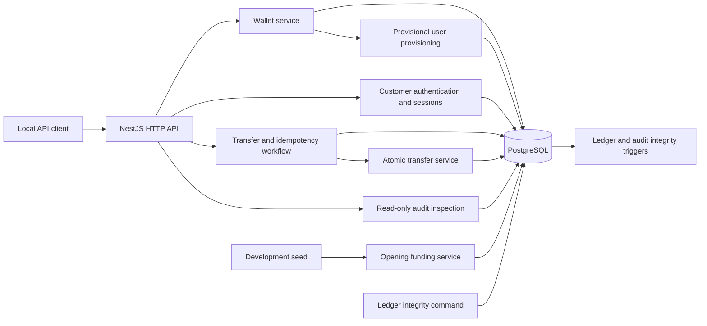

# Phase 1 through 2B architecture

LedgerFlow is a NestJS modular monolith backed by PostgreSQL. Prisma provides typed database access; PostgreSQL constraints and triggers enforce the financial invariants.

Phase 2A adds required wallet-to-user ownership in PostgreSQL. Phase 2B activates registration, login, refresh, logout, and identity routes. New customers have bcrypt password hashes and database-backed sessions. JWT access cookies are accepted only while their PostgreSQL session and user remain active. Opaque refresh tokens are stored only by SHA-256 hash; rotation consumes a token under a session row lock, and reuse revokes the session. Authentication audit records omit credentials and token values. `access-control/` remains reserved: the `test-*` owner reference still drives local transfer simulation and is not authentication. Provisional users are suspended and passwordless. See [the migration notes](phase2a-identity-migration.md).

Wallet creation, simulated funding, and successful transfers write their audit records in the same PostgreSQL transaction as their state changes. The transfer HTTP workflow reserves a unique idempotency row before calling the atomic transfer service. PostgreSQL coordinates simultaneous requests that use the same actor, operation, and key. Rejections are audited in a separate database write after the financial transaction rolls back.

The ledger is the financial source of truth. A posted journal has at least two signed entries that sum to zero, and its posting trigger updates the cached account balances. The integrity command independently recalculates posted journal totals and wallet balances. It reports discrepancies without modifying data.

Transfer and audit inspection routes are restricted to loopback requests in development or test mode. The simulated actor header is not authentication.

Browser auth writes check the exact configured Origin and Fetch Metadata where present. These checks are an interim defense, not the complete CSRF protection planned for Phase 2D. The Phase 2B authentication cookies must not be treated as production-ready browser security or as authorization for existing financial routes.
