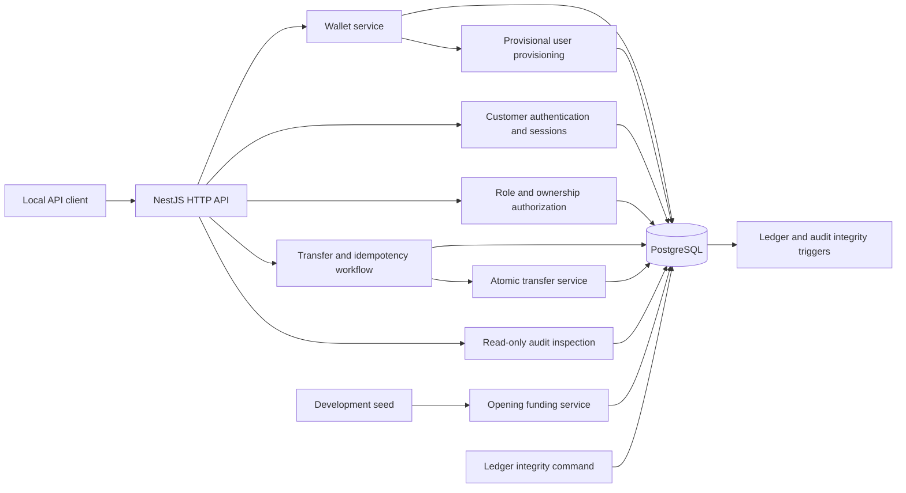

# Phase 1 through 2D architecture

LedgerFlow is a NestJS modular monolith backed by PostgreSQL. Prisma provides typed database access; PostgreSQL constraints and triggers enforce the financial invariants.

Phase 2A adds required wallet-to-user ownership in PostgreSQL. Phase 2B activates registration, login, refresh, logout, and identity routes. New customers have bcrypt password hashes and database-backed sessions. JWT access cookies are accepted only while their PostgreSQL session and user remain active. Opaque refresh tokens are stored only by SHA-256 hash; rotation consumes a token under a session row lock, and reuse revokes the session. Authentication audit records omit credentials and token values. Phase 2C applies global authentication and deny-by-default role guards, plus database ownership checks to financial routes. The `test-*` owner reference remains only for local provisional wallet creation and historical regression tests; it is not transfer authority. Provisional users are suspended and passwordless. See [the migration notes](phase2a-identity-migration.md).

Wallet creation, simulated funding, and successful transfers write their audit records in the same PostgreSQL transaction as their state changes. The transfer HTTP workflow reserves a unique idempotency row before calling the atomic transfer service. PostgreSQL coordinates simultaneous requests that use the same actor, operation, and key. Rejections are audited in a separate database write after the financial transaction rolls back.

The ledger is the financial source of truth. A posted journal has at least two signed entries that sum to zero, and its posting trigger updates the cached account balances. The integrity command independently recalculates posted journal totals and wallet balances. It reports discrepancies without modifying data.

The transfer route uses the authenticated user's ID for idempotency scope and verifies source ownership and active status under database locks. Customer reads are wallet-scoped, while operations/admin reads support investigations. Staff cannot submit customer transfers. Admin role/status changes are audited and serialize checks that preserve an active administrator. The simulated actor header is not authentication.

Phase 2D adds session-bound HMAC CSRF tokens for all cookie-authenticated writes, including refresh, logout, transfers, and administration. Login/registration remain Origin/Fetch Metadata protected. A browser can read the token from the login or refresh response header, or from authenticated `GET /api/v1/auth/csrf`; no CSRF token is put in a cookie. Credentialed CORS is restricted to exact configured origins. Helmet headers, bounded bodies, strict DTO validation, safe error envelopes, and request metadata logging harden the HTTP boundary. Throttling has separate IP policies for general, authentication, refresh, transfer, and admin traffic, plus an account-based login/registration policy. The throttle store is process-local, so deployment is limited to a single API instance until shared storage is configured.
