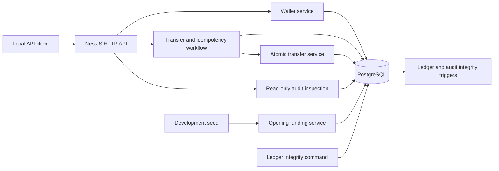

# Phase 1 architecture

LedgerFlow is a NestJS modular monolith backed by PostgreSQL. Prisma provides typed database access; PostgreSQL constraints and triggers enforce the financial invariants.

Wallet creation, simulated funding, and successful transfers write their audit records in the same PostgreSQL transaction as their state changes. The transfer HTTP workflow reserves a unique idempotency row before calling the atomic transfer service. PostgreSQL coordinates simultaneous requests that use the same actor, operation, and key. Rejections are audited in a separate database write after the financial transaction rolls back.

The ledger is the financial source of truth. A posted journal has at least two signed entries that sum to zero, and its posting trigger updates the cached account balances. The integrity command independently recalculates posted journal totals and wallet balances. It reports discrepancies without modifying data.

Transfer and audit inspection routes are restricted to loopback requests in development or test mode. The simulated actor header is not authentication.
